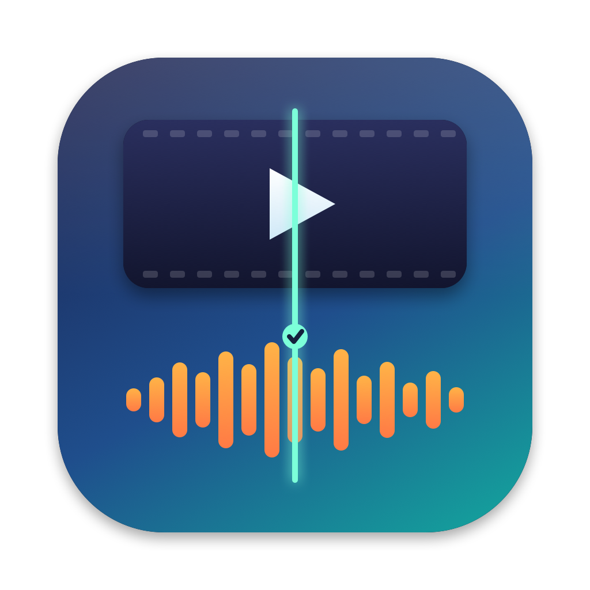

# Syncwright

A Mac app that checks whether the sound in a video file lines up with the picture, and corrects it when it does not. It is built for TV episodes and recordings, and it keeps the file's format and encoding as they are wherever that is possible.

- **Checks the whole file**, not just the start. It follows lip movement against speech through the episode, so it works on ordinary dialogue-heavy TV.
- **Fixes without re-encoding.** Video, audio, subtitles and chapters are copied as they are into a new file with the same container. Only the audio timing changes.
- **Offers a re-encode only when needed**, for example when the sync drifts through the episode. Then only the audio is re-encoded, with the same codec, bitrate and channels. The video is never touched.
- **Batch ready.** Drop several episodes or a whole season folder. Each file is checked in turn and "Fix All Needed" repairs the ones that need it.
- **Safe.** Your original is never changed. The corrected copy is saved next to it with `_synced` in the name, and every output is verified and deleted if it is damaged.
- **Plex friendly.** The output keeps the video start time at zero, keeps the MP4 brand and track names, and avoids the extra boxes that stop Plex playing some remuxed MP4 files.

## Requirements

- macOS 13 or later.
- [ffmpeg](https://ffmpeg.org) and ffprobe. Install them with Homebrew: `brew install ffmpeg`.

## Using it

1. Open Syncwright and drop one or more video files, or a folder, on the window. Or choose **Add**.
2. Wait for the check. A file shows "In sync", "Audio X ms late", "Audio X ms early" or "Could not determine".
3. Select a file to see a chart of the audio delay through the episode and how confident the result is.
4. Press **Fix Sync** for that file, or **Fix All Needed** for the whole list.
5. Press **Check Result** on a fixed file to run the check again on the new copy.

See [Getting started](docs/getting-started.md) for the details, [How the check works](docs/how-it-works.md) for what the numbers mean, and [Fixing sync](docs/fixing.md) for what the app writes and when it offers a re-encode.

## Limits

- Detection needs dialogue with visible faces, or sound that lines up with movement. Scenes with no faces, heavy music or narration over footage give weak results. The app says "Could not determine" rather than guess.
- It searches for an offset of up to 3 seconds either way.
- Accuracy is about 40 ms, which is below what most people notice.
- A single shift cannot fix sync that drifts or jumps during a file. For that, the app offers the audio re-encode.

## Licence

Copyright © 2026 Ray Munro. All rights reserved. See [LICENSE](LICENSE).
