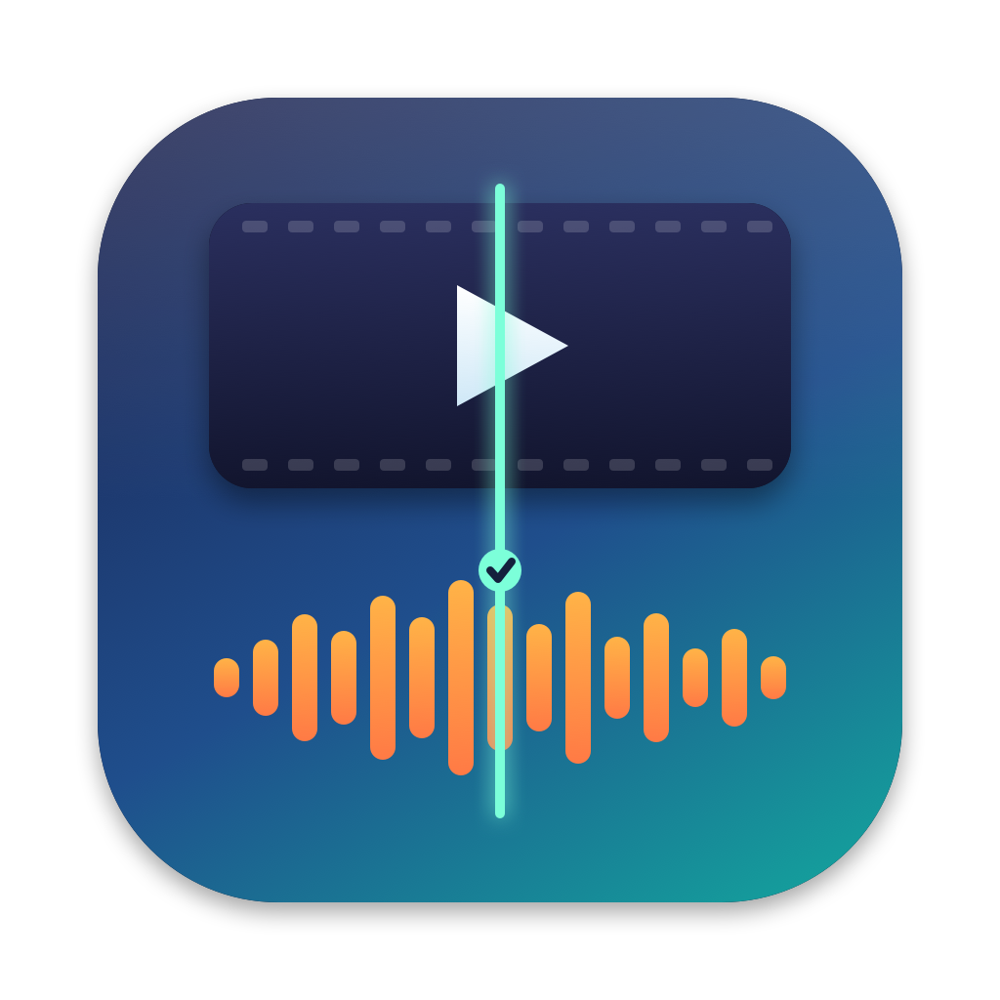

<p align="center"></p>

# Building from source

Syncwright is a Swift Package that builds a SwiftUI macOS app.

## Requirements

- macOS 13 or later, with Xcode or the Xcode command line tools (Swift 5.9 or later).
- ffmpeg and ffprobe at run time: `brew install ffmpeg`.
- Google Chrome, to render the documentation PDF.

## Building the app

```
./build_app.sh
open Syncwright.app
```

`build_app.sh` builds a release binary, assembles Syncwright.app with its icon and Info.plist, and signs it with your Apple Development certificate if you have one (otherwise ad hoc).

## Building the disk image

```
./make_dmg.sh
```

This builds the app, renders the documentation PDF, and creates `dist/Syncwright-<version>.dmg` containing the app, an Applications shortcut, the documentation, the guides and the licence.

## Testing from the command line

The app binary has a headless mode for testing:

```
Syncwright.app/Contents/MacOS/Syncwright --analyze video.mp4
Syncwright.app/Contents/MacOS/Syncwright --analyze video.mp4 --fix out.mp4 120
Syncwright.app/Contents/MacOS/Syncwright --analyze video.mp4 --reencode out.mp4
```

The first prints the measured offset. The second writes a corrected copy with the audio delay given in milliseconds. The third writes an audio re-encoded copy. Set `SYNCWRIGHT_DEBUG=1` for per-section details.

## Other tools

| Tool | Purpose |
|---|---|
| `tools/make_icon.swift` | Draws the app icon into `Resources/AppIcon-1024.png` |
| `tools/make_docs_pdf.py` | Renders the documentation chapters into `docs/Syncwright-Documentation.pdf` |
| `tools/make_dmg_bg.swift` | Draws the disk image window background |
| `tools/make_dmg_icon.swift` | Draws the disk image's own icon |
| `tools/set_file_icon.swift` | Gives the finished `.dmg` file that icon in Finder |

## Project layout

| File | Purpose |
|---|---|
| `Sources/Syncwright/Analyzer.swift` | Reads the file and measures the offset |
| `Sources/Syncwright/Fixer.swift` | Writes the corrected file and verifies it |
| `Sources/Syncwright/Tools.swift` | Runs ffmpeg and ffprobe |
| `Sources/Syncwright/ContentView.swift` | The window |
| `Sources/Syncwright/App.swift` | App entry point and test mode |
