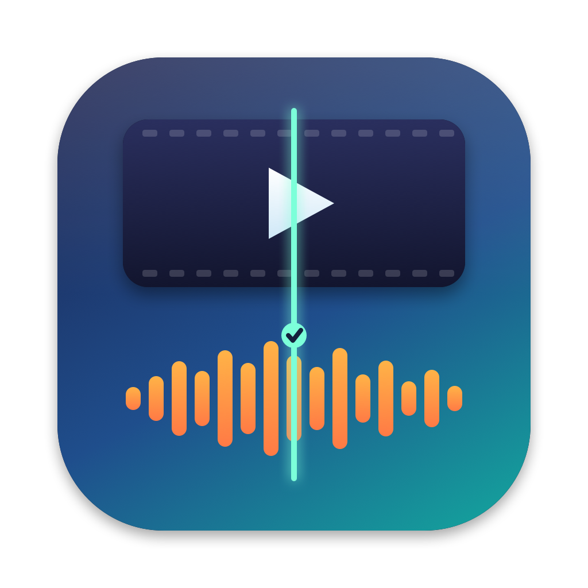

# Getting started

## Install

1. Install ffmpeg once: `brew install ffmpeg`.
2. Open the disk image and drag Syncwright to Applications.
3. The first time you open it, right-click the app and choose **Open** if macOS asks you to confirm.

## Add files

Drop video files, or a folder, onto the window. Folders are searched for `mkv`, `mp4`, `m4v`, `mov`, `avi`, `ts`, `m2ts`, `mpg`, `mpeg`, `webm` and `wmv` files. Files whose name already ends in `_synced` are skipped. You can also use the **Add** button.

Files are checked one after another. The sidebar shows progress for the file being checked.

## Read the result

Select a file to see:

- **The verdict.** "In sync" means the audio is within 40 ms of the picture. Otherwise it says how many milliseconds the audio is late or early.
- **Confidence.** High, Medium or Low. See [How the check works](how-it-works.md).
- **The chart.** Each dot is a section of the file, showing how late the audio is there. Blue dots are sections that matched well. Grey dots did not match and are ignored.
- **A note.** If the sync drifts or jumps during the file, the note says so.

## Fix a file

The **Audio delay to remove** box is filled in from the check. You can change it if you know better. Positive means the sound arrives after the picture.

- **Fix Sync** saves a corrected copy without re-encoding.
- **Fix All Needed** does the same for every checked file that is at least 40 ms out and has Medium or High confidence.
- **Fix by Re-encoding Audio** appears when a single shift cannot keep the file in sync. See [Fixing sync](fixing.md).

The new file is saved next to the original as `name_synced.ext`. If that name exists, a number is added. Press **Show in Finder** to find it, or **Check Result** to run the check on it.

## Time it takes

The whole file is decoded and every frame is searched for faces, so a feature-length episode takes several minutes. Files are checked one at a time so the Mac stays responsive.
